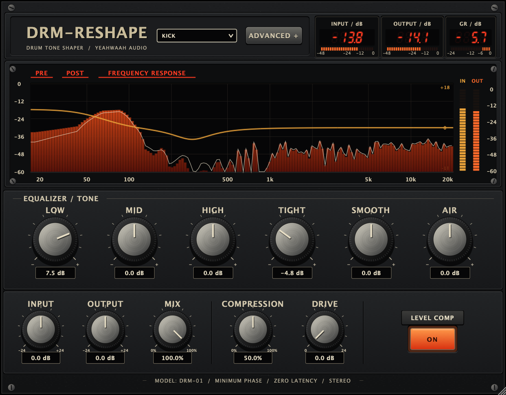

## DRM-RESHAPE v1.2.0 — Vintage Hardware UI

### Why you'll like it

DRM-RESHAPE is a drum-focused EQ and tone shaper by yeahwaah audio. It gets a drum bus or single drum sounding right quickly:

- **Fast starting points** for Kick, Snare, Toms, Overheads, Room and Full Kit.
- **Six focused bands** (LOW, MID, HIGH, TIGHT, SMOOTH, AIR) instead of endless EQ nodes.
- **Dynamic TIGHT and SMOOTH** that only act when the problem frequency appears.
- **One-knob Compression and Drive** macros, with wet/dry blend and level compensation so you can judge changes at matched loudness.
- **See what you hear**: live pre/post spectrum and EQ response curve, plus input, output and gain-reduction meters.

### Release notes

**New look (UI only; sound and parameters are unchanged)**

- Complete redesign as a vintage rack-hardware unit: chassis, hardware-style knobs and an illuminated LEVEL COMP button.
- Seven-segment numeric readouts and LED ladder meters for input, output and gain reduction.
- New spectrum analyzer with log-frequency bars, a PRE trace, an EQ response curve, and clickable PRE / POST / FREQUENCY RESPONSE tabs.
- Advanced pages (Bands, Dynamics) restyled to match.
- Resizable window with fixed aspect ratio (about 710–1700 px wide); the layout scales cleanly.

**Behaviour changes to be aware of**

- The per-band on/off switches and the BYPASS button were removed from the UI. The parameters still exist, and saved sessions and automation keep working.

**Not changed**

- DSP, parameter IDs and presets. Existing projects load as before.

**Verified**

- Windows VST3 and Standalone builds pass; DSP checks pass. Tested by hand in REAPER on Windows.
