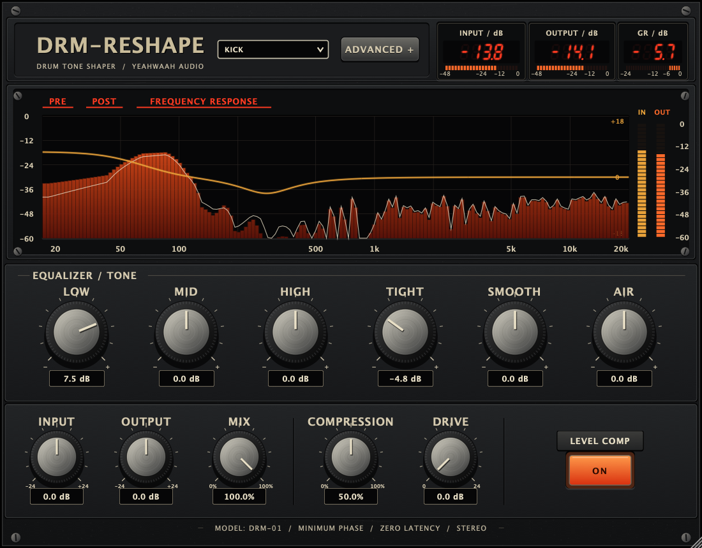

## DRM-RESHAPE v1.2.1 — Readable Meters

### Why you'll like it

DRM-RESHAPE is a drum-focused EQ and tone shaper by yeahwaah audio. It gets a drum bus or single drum sounding right quickly:

- **Fast starting points** for Kick, Snare, Toms, Overheads, Room and Full Kit.
- **Six focused bands** (LOW, MID, HIGH, TIGHT, SMOOTH, AIR) instead of endless EQ nodes.
- **Dynamic TIGHT and SMOOTH** that only act when the problem frequency appears.
- **One-knob Compression and Drive** macros, with wet/dry blend and level compensation so you can judge changes at matched loudness.
- **See what you hear**: live pre/post spectrum and EQ response curve, plus input, output and gain-reduction meters.

### Release notes

**v1.2.1 — Meter readability**

- The numeric input, output and gain-reduction readouts now use peak hold. Each number holds its highest value for 1.5 s, then falls at 15 dB/s, so you can actually read it while the signal moves.
- The LED bar ladders are unchanged and still follow the signal live.
- UI only: DSP, parameters and presets are unchanged.

**v1.2.0 — Vintage Hardware UI (included)**

- Complete redesign as a vintage rack-hardware unit: chassis, hardware-style knobs and an illuminated LEVEL COMP button.
- Seven-segment readouts and LED ladder meters.
- Spectrum analyzer with log-frequency bars, a PRE trace, an EQ response curve, and clickable PRE / POST / FREQUENCY RESPONSE tabs.
- Restyled Advanced pages (Bands, Dynamics) and a resizable window with fixed aspect ratio.
- The per-band on/off switches and the BYPASS button were removed from the UI. The parameters still exist, and saved sessions keep working.

**Verified**

- Windows VST3 and Standalone builds pass; DSP checks pass. Tested by hand in REAPER on Windows.
