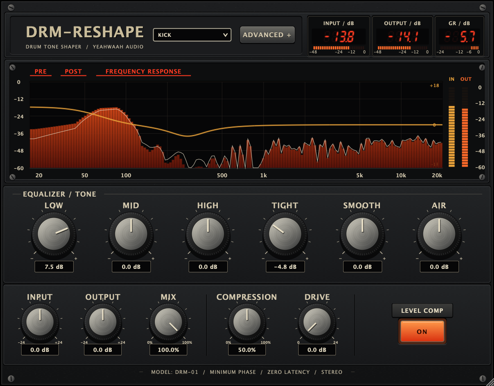

## DRM-RESHAPE v1.3.0 — Hi-Hats

### Why you'll like it

DRM-RESHAPE is a drum-focused EQ and tone shaper by yeahwaah audio. It gets a drum bus or single drum sounding right quickly:

- **Fast starting points** for Kick, Snare, Toms, Overheads, Room, Full Kit and Hi-Hats.
- **Six focused bands** (LOW, MID, HIGH, TIGHT, SMOOTH, AIR) instead of endless EQ nodes.
- **Dynamic TIGHT and SMOOTH** that only act when the problem frequency appears.
- **One-knob Compression and Drive** macros, with wet/dry blend and level compensation so you can judge changes at matched loudness.
- **See what you hear**: live pre/post spectrum and EQ response curve, plus input, output and gain-reduction meters.
- **Mono or stereo tracks**: supports both mono and stereo track layouts.

### Release notes

**v1.3.0 — Hi-Hats**

- New **Hi-Hats** instrument starting point (LOW 250, MID 1000, HIGH 8000, TIGHT 400, SMOOTH 5500, AIR 15000 Hz). It is added at the end of the list, so saved sessions keep their instrument.
- DSP and other parameters are unchanged.

**v1.2.1 — Meter readability**

- The numeric input, output and gain-reduction readouts use peak hold: each number holds its highest value for 1.5 s, then falls at 15 dB/s. The LED bars still follow the signal live.

**v1.2.0 — Vintage Hardware UI**

- Complete redesign as a vintage rack-hardware unit: chassis, hardware-style knobs and an illuminated LEVEL COMP button.
- Seven-segment readouts, LED ladder meters, and a spectrum analyzer with PRE trace, EQ response curve and clickable PRE / POST / FREQUENCY RESPONSE tabs.
- Restyled Advanced pages and a resizable window with fixed aspect ratio.
- The per-band on/off switches and the BYPASS button were removed from the UI. The parameters still exist, and saved sessions keep working.

**Verified**

- Windows VST3 and Standalone builds pass; DSP checks pass. Tested by hand in REAPER on Windows.
