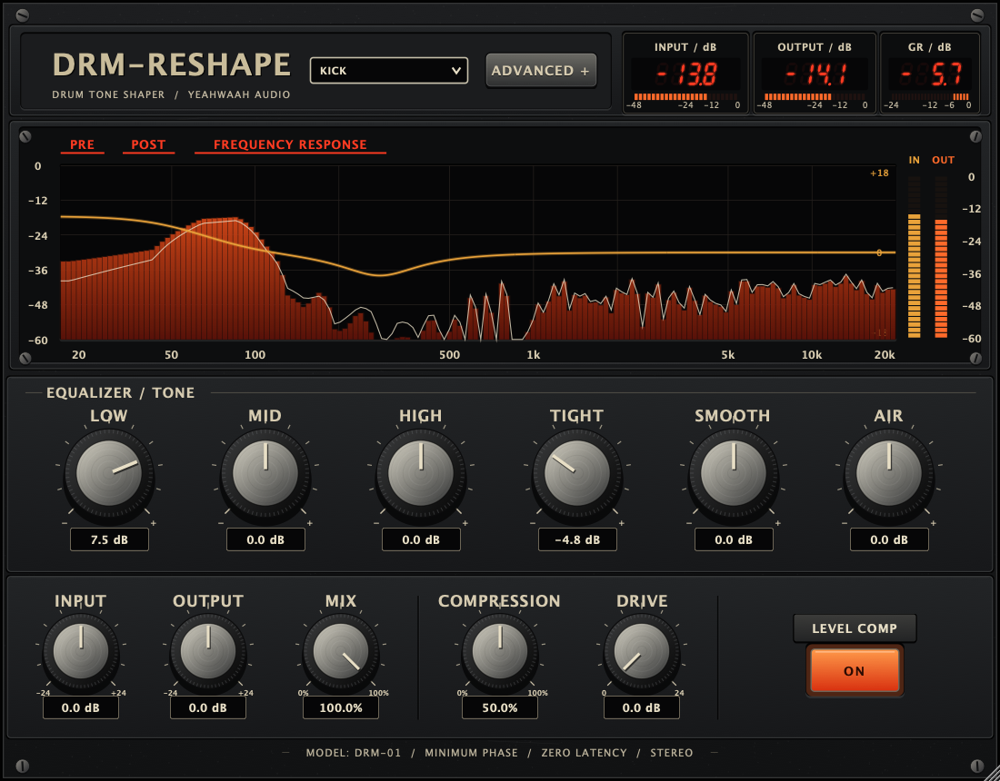

## DRM-RESHAPE v1.4.0 — Compressor Types

### Built for bedroom producers and mixers

DRM-RESHAPE is made on purpose for people mixing on a laptop or modest computer who don't have the CPU, RAM or processing headroom to spare for oversampling. It does not oversample, and it adds no latency. Drum EQ, compression and saturation run on a light processing budget, so you can put one on every drum track without the session choking.

### What it does for your workflow

Get a drum sounding right in a few moves instead of building an EQ from scratch: pick the instrument, nudge six focused bands, pick a compressor flavour, and you can see the result live on the analyzer and meters. It replaces a chain of separate EQ, compressor and saturator plugins with one small one.

### Features

- **Instrument starting points:** Kick, Snare, Toms, Overheads, Room, Full Kit and Hi-Hats.
- **Six focused bands:** LOW, MID, HIGH, TIGHT, SMOOTH and AIR, with an Advanced page for frequency, Q and gain.
- **Dynamic TIGHT and SMOOTH:** Act only when the problem frequency appears.
- **Three compressor types:** Transparent, Vintage (1176-style) and Slam.
- **Compressor position:** Place the compressor before or after the EQ.
- **Drive:** Soft saturation, plus wet/dry mix and input/output trim.
- **Live feedback:** Pre/post spectrum, EQ response curve, input/output ladders, and numeric readouts with peak hold.
- **Mono and stereo tracks:** Supports both mono and stereo track layouts.
- **Vintage rack-hardware interface:** Resizable window that scales cleanly.

### Release notes

**v1.4.0 — Compressor types**

- **Compression type** dropdown under the COMPRESSION knob:
  - **Transparent:** The compressor from earlier versions (default), unchanged.
  - **Vintage:** 1176-style behaviour with a fast attack, program-dependent release, a ratio that rises from 1:1 to 12:1, and gentle FET-style colour.
  - **Slam:** A heavy 20:1 squash blended in parallel with the dry signal, with makeup on the squashed path.
- **PRE EQ / POST EQ** dropdown to put the compressor before or after the EQ. The default is POST EQ, as before. Saturation stays at the end of the chain.
- The numeric meter readouts now show whole dB (no decimals), alongside peak hold.
- **The plugin name now includes its version** (for example `DRM-RESHAPE-1.4.0`) in your DAW's plugin list and in the file name.
- Existing sessions sound the same: new parameters default to the previous behaviour.

**Heads-up: versioned plugin name**

- Because the version is in the name, some DAWs may treat each version as a separate plugin. Projects saved with an older version can show it as missing until you load the new one or keep the old file installed. Keep the old `.vst3` next to the new one if you need old projects to open untouched.

**Earlier in this line**

- **v1.3.0:** Added the Hi-Hats instrument.
- **v1.2.1:** Numeric meter readouts hold their peak for 1.5 s, then fall at 15 dB/s.
- **v1.2.0:** Vintage rack-hardware redesign, with a spectrum analyzer, LED meters and a resizable window.

**Verified**

- Windows VST3 and Standalone builds pass; DSP checks pass for each compressor type. Tested by hand in REAPER on Windows.

**Not yet available**

- AAX (Pro Tools) is planned for the future.
